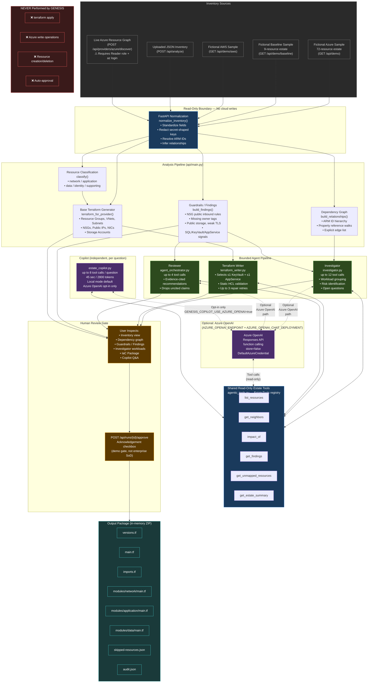
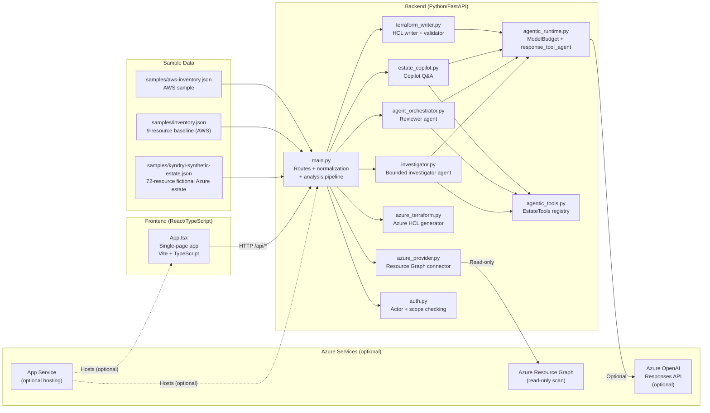

# GENESIS — Architecture Diagram

## System Data Flow

---

## Component Relationships

---

## Read-Only and Human Approval Boundaries

```mermaid
flowchart LR
    subgraph SAFE["Safe — Read-Only Zone"]
        direction TB
        SCAN["Azure Resource Graph scan\n(Reader role, indexed snapshot)"]
        TOOLS["EstateTools registry\n(list, neighbor, impact, findings only)"]
        MODEL["Azure OpenAI Responses API\n(store=false, bounded prompts)"]
        CRED["DefaultAzureCredential\n(CLI or managed identity — never in browser)"]
    end

    subgraph HUMAN["Human Approval Zone"]
        direction TB
        REVIEW["User reviews all outputs\nin the GENESIS UI"]
        ACK["Acknowledgement checkbox\nPOST /api/runs/{id}/approve"]
        DOWNLOAD["ZIP download enabled\nGET /api/runs/{id}/package"]
    end

    subgraph NEVER2["Explicitly Out of Scope"]
        direction TB
        NA["No terraform apply"]
        NB["No Azure write APIs"]
        NC["No auto-approve"]
        ND["No resource creation"]
        NE["No credential exposure\nto browser"]
    end

    SAFE --> HUMAN
    HUMAN -->|"Only after\nacknowledgement"| DOWNLOAD
    NEVER2 -. "blocked" .- SAFE
    NEVER2 -. "blocked" .- HUMAN
```

---

## Notes on Diagram Accuracy

- **Azure Resource Graph** is shown as optional because the full demo runs without Azure credentials using the fictional sample.
- **Azure OpenAI** is shown as optional because all agents have deterministic local fallbacks; the system is fully functional without a model deployment.
- **App Service hosting** is optional; the demo runs locally on `http://127.0.0.1:5173`.
- The **72 resources / 124 relationships / 5 modules / 21 findings** values are from the fictional `kyndryl-synthetic-estate.json` demo estate, not from a real Kyndryl or customer environment.
- The **1 critical finding** shown in the UI corresponds to a public inbound NSG rule in the fictional synthetic estate.
